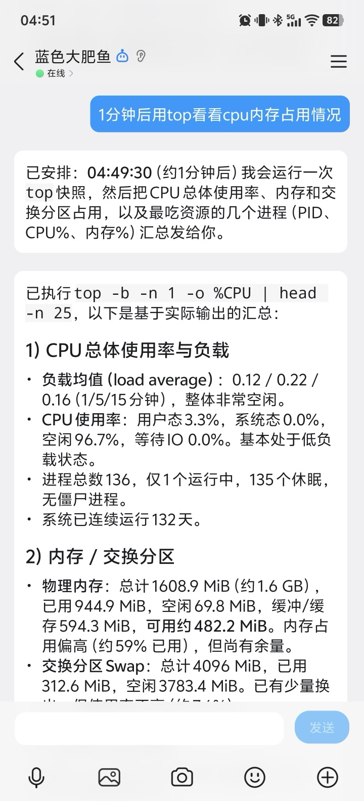
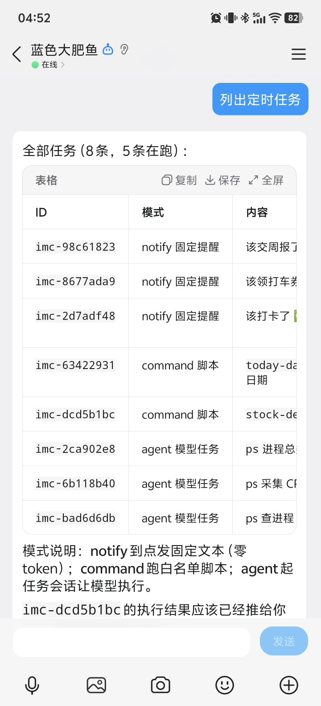

# dsh-im-cron

**English** | [简体中文](README.zh-CN.md)

[](https://github.com/deepseek-ai/deepseek-harness)

**A [DeepSeek Harness](https://github.com/deepseek-ai/deepseek-harness) (DSH) plugin that adds scheduled tasks to IM chats**, for [`@xmanrui/dsh-im`](https://www.npmjs.com/package/@xmanrui/dsh-im). Create a task in the chat, let it run on time, get the result back in the same chat.

> Companion plugin for dsh-im, not a standalone IM channel.

## Screenshots

| A scheduled `agent` task in QQ | `imcron_list` in the chat |
|---|---|
|  |  |

---

## What it does (and does not)

This plugin **does not connect to an IM platform, send messages, or manage sessions**. It decides *when* to run, *what* to run, and *where the result goes*; dsh-im owns the channel.

| Concern | Owned by |
|---|---|
| IM connection, session binding, proactive send, target management | **dsh-im** |
| Scheduling, execution, result collection, bookkeeping | **this plugin** |

Delivery goes through dsh-im's `dshIm` service (`contractVersion: 1`). This plugin imports no dsh-im code; it only calls `send` / `describeConversation` / `resolveTarget`.

DSH's built-in `schedule_*` runs inside a session and only pushes the answer when `deliverModelAnswers` is on (off by default), so "remind me at 9" is silent by default. This plugin decouples the three concerns:

| Question | Answer |
|---|---|
| When does it run? | this plugin's scheduler (see [Scheduling precision](#scheduling-precision)) |
| Where does it run? | a dedicated task session for `agent`, not bound to the chat |
| Who receives it? | dsh-im's `botId + targetId`, decoupled from the session — a user `/new` does not affect delivery |

**Without dsh-im**: declared `jobs` (with an explicit target) still run and are logged to `runs.jsonl`, but there is no delivery channel — delivery is retried with backoff and the run records `deliver.status: pending`. Creating a task from a chat needs dsh-im, because the target is resolved from the conversation.

```text
You (QQ): remind me to write the daily report every morning at 9
Bot: created imc-98c61823, next run 11-23 09:00

—— next day 09:00 ——
Bot: Daily report ✍️
```

---

## Three payloads

| Payload | On the deadline | Model cost |
|---|---|---|
| `notify` | send a fixed piece of text | **0** |
| `command` | spawn a script, push stdout back | **0** |
| `agent` | run **one** agent turn in a dedicated task session, push the answer back | 1 turn |

`notify` / `command` never touch a model. `agent` uses a model for execution only; delivery is model-free.

---

## Requirements

| Item | Required | Version |
|---|---|---|
| Node.js | ✅ | `>= 24.9.0` (same as DSH) |
| DeepSeek Harness | ✅ | `>= 0.2.2-rc.0 < 0.3.0` (enforced by `engines.dsh`) |
| pnpm | ✅ | any recent release; `dsh plugin` forwards its arguments to pnpm |
| [`@xmanrui/dsh-im`](https://www.npmjs.com/package/@xmanrui/dsh-im) | **✅ for delivery** | `5.10.0` (the `dshIm` contract was verified against this version) |
| Platform | — | macOS tested; Linux expected to work but untested; Windows is statically checked only — the `command` payload accepts `.exe`/`.com` only (no shell, so no `.sh`/`.cmd`/`.bat`) |

---

## Channels

Routing is table-driven; the route shape follows dsh-im's `normalizeRoute`.

| Channel | Direct | Group | Route keys | Status |
|---|---|---|---|---|
| `qq` | ✅ | ✅ | `userOpenId` / `groupOpenId` | tested on a real bot |
| `feishu` | ✅ | — | `openId` | structural; group and thread are rejected |
| `weixin` | ✅ | — | `toUserId` | structural; dsh-im has no group route |
| `dingtalk` | ✅ | ✅ | `userId` / `openConversationId` | structural |
| `wecom` | ✅ | ✅ | `chatId` (both) | structural |

`allowChannels` defaults to all five. A channel still needs a live bot in dsh-im; the list only controls where tasks may be created. Direct-chat address is `senderId` (wecom also sets `chatId` to the same id); group address is `chatId`. Feishu group/thread (`channel-unsupported` / `thread-unsupported`), weixin groups, and any other dsh-im channel (`slack`, `telegram`, …) are rejected explicitly.

The matrix is honest about verification: only QQ was run against a real bot; the others are checked against dsh-im's source and covered by unit tests. Declarative `jobs` default `target.channel` to `qq`; set it explicitly for another channel.

---

## Install

**① pnpm on PATH** (`dsh plugin` forwards to pnpm):

```bash
npm install -g pnpm    # skip when `pnpm --version` already works
```

**② Install and configure dsh-im first** (at least one bot + a receive target), and confirm it can send and receive:

```bash
dsh plugin --profile web add @xmanrui/dsh-im
```

**③ Install this plugin**:

```bash
dsh plugin --profile web add dsh-im-cron                 # from npm
dsh plugin --profile web add github:mashago/dsh-im-cron  # from the repository
dsh plugin --profile web add /path/to/dsh-im-cron        # local directory / tarball
```

**④ Restart `dsh web`** so the rows load. Plugin code is read at startup, and enabling or upgrading also needs a restart. A `github:` install pins the resolved commit; upgrade with `remove` + `add` (a plain `add` keeps the lockfile).

Both plugins must live in the **same DSH instance and the same profile** — this plugin finds dsh-im via `ctx.get('dshIm')`.

Confirm the rows were inserted:

```bash
dsh --profile web --dump-config | grep im-cron
```

The startup log should show:

```text
[im-cron] delivery=dshIm agent=on jobs=N stateDir=~/.dsh/im-cron
```

`delivery=pending` means dsh-im was not detected at startup (it is probed again on every use): `notify` / `command` still run, delivery stays pending.

> **Changing the main row (`im-cron`: `timezone`, `scriptDir`, `activeHours`, `jobs`, caps, …) needs a DSH restart.**
> Two things are live: the group-chat switch, and the agent task-session settings on the Plugins page
> (they take effect on the next agent run after saving).

---

## Quick start

| You say | Payload created |
|---|---|
| "remind me about the meeting in 1 minute" | `notify` + `at` |
| "remind me to write the daily report every morning at 9" | `notify` + `cron` |
| "run stock-report.sh in 1 minute and tell me when it's done" | `command` + `at` |
| "run the closing script at 15:30 every day, no notification" | `command` + `cron` + `notify:never` |
| "summarize the financial news at 9 every day" | `agent` + `cron` |
| "check the processes every 2 minutes, stop after 3 runs" | `agent` + `every{minute,2}` + `maxRuns:3` |

Script payloads need the script placed in the [script directory](#script-payload) first.

---

## Tools

Nine tools, all registered on the global row `im-cron-tools` and visible to any agent.

| Tool | Purpose | Key arguments |
|---|---|---|
| `imcron_remind` | send a fixed text on schedule | `text`, `at`/`cron`/`every`, `timezone?`, `maxRuns?` |
| `imcron_run` | spawn a script on schedule | `script`, `timeoutSeconds?`, schedule, `notify?`, `maxRuns?` |
| `imcron_ask` | run one turn on schedule | `prompt`, schedule, `notify?` (`always`/`never`), `timeoutSeconds?`, `maxRuns?` |
| `imcron_list` | this chat's tasks, next run, last result | — |
| `imcron_update` | change schedule / text / `notify` / `maxRuns` | `id` + the fields above |
| `imcron_remove` | delete a task (**not** the delivery target) | `id` |
| `imcron_pause` / `imcron_resume` | pause / resume | `id` |
| `imcron_trigger` | run once now, without changing the schedule or the water mark | `id` |

Behavior notes:

- Creation returns `{ id, nextRunAt, next3 }`; `next3` lets the user confirm the time on the spot.
- `imcron_update` changes schedule / text / `notify` / `maxRuns` only; **payload type and target cannot be changed** — delete and recreate.
- Changing the schedule **re-anchors** it (old slots never fire) and clears a `needs-rebind` delivery state or an `invalid` payload state, so the job runs again. A text-only update leaves both alone; fix the target (or the payload) and use `imcron_resume`.
- `imcron_resume` also clears `needs-rebind` and `invalid`. Clearing `invalid` does not repair the payload: the next run fails again and records the reason, which is the only visible signal for a chat-created job whose payload cannot be edited.
- `imcron_list` does not return `sessionId` (only CLI `--verbose` and `runs.jsonl` do), and renders **enabled / paused / finished**, plus a hint when a job needs a rebind or its payload is invalid.
- Target isolation: the model cannot name a bot or a chat; the target comes from the current session. Management tools cannot see another chat's jobs (their ids and "not found" return the same error).
- `imcron_trigger` does not consume the `maxRuns` budget.

### Native `schedule_*` is disabled in IM sessions

Three layers, only the last one is mandatory:

| Layer | Mechanism |
|---|---|
| Prompt | system prompt section `tool:imcron` (IM sessions only, filtered by session id) |
| Visibility | `agent/created` → `tools.restrict({deny:['schedule_create','schedule_edit','schedule_list','schedule_view']})` |
| **Execution** | the `tools/execute` guard returns `isError`; the tool body never runs |

Native answers are not pushed by default, and the model reaches for those tools first. **Web / desktop sessions are untouched.**

---

## Time expressions

Three kinds, **mutually exclusive**:

```jsonc
// one-shot
{ "at": "2026-11-21T09:00:00+08:00" }
{ "at": { "date": "2026-11-21", "time": "09:00", "timezone": "Asia/Shanghai" } }

// wall-clock rules (5 fields)
{ "cron": "0 9 * * 1-5", "timezone": "Asia/Shanghai" }   // weekdays at 9
{ "cron": "0 9,18 * * *" }                               // every day at 9 and 18
{ "cron": "0 9 1 * *" }                                  // the 1st of every month
{ "cron": "0 9 L * *" }                                  // the last day of every month

// intervals
{ "every": { "unit": "minute", "count": 90 } }                            // every 90 minutes
{ "every": { "unit": "hour", "count": 3 } }                               // every 3 hours from now
{ "every": { "unit": "day", "count": 15, "at": "06:00", "timezone": "Asia/Shanghai" } }
{ "every": { "unit": "week", "count": 2, "at": "10:00", "timezone": "Asia/Shanghai" } }
```

| The user says | Use |
|---|---|
| a specific instant / a specific day | `at` |
| weekdays, several times a day, a day of the month, a month | **`cron`** (`every` cannot express these) |
| every N minutes / hours / days / weeks | `every` |

Rules:

- `cron` accepts exactly 5 fields; it rejects a seconds field, macros (`@daily`), "value + step" (`0/15`), and expressions with no future occurrence (e.g. `0 9 30 2 *`). It supports `L` (last day of month).
- `cron` takes **local wall-clock time**; do not convert to UTC first.
- `*/15` means "the 1st, 16th and 31st of each month", **not** "every 15 days". Use `every{day,15}`.
- `every` with `minute` / `hour` is **instant-based**: anchored to the whole minute at creation, so the interval is unchanged across DST.
- `every` with `day` / `week` follows the **local calendar**: wall-clock time is preserved across DST; a gap moves forward, an overlap takes the earlier instant.
- `at` must be strictly in the future; an instant in a DST gap is rejected.

> **First run**: `every{day|week, at}` starts at the **first future `at`** — a "every 15 days at 6am" task created in the afternoon first runs **tomorrow** at 06:00, not 15 days later. `minute` / `hour` count from the whole minute at creation. Check `next3` on creation.

---

## Configuration

```yaml
- insert:
    - id: im-cron
      name: dsh-im-cron
      config:
        timezone: Asia/Shanghai
        scriptDir: ~/.dsh/im-cron/workspace
        activeHours: { start: '08:00', end: '22:00' }
        agent:
          enabled: true
          timeoutSeconds: 900
          permissionPreset: danger-full-access
        # operator-declared tasks (no model involved)
        jobs:
          - id: decl-close
            name: closing prices
            schedule: { cron: '30 15 * * 1-5', timezone: Asia/Shanghai }
            payload: { kind: command, script: stock-report.sh }
            deliver: always
            target: { botId: qq_xxxxxxxxxxxxxxxx, targetId: cron-0123456789ab }
```

| Key | Default | Description |
|---|---|---|
| `channel` | `dshIm` | channel id (only dsh-im today) |
| `stateDir` | `$DSH_HOME/im-cron` | state directory |
| `scriptDir` | `<stateDir>/workspace` | script directory, see [Script payload](#script-payload). **The plugin does not create it** |
| `timezone` | host time zone | default zone for parsing / displaying schedules |
| `pollSeconds` | `30` | fallback sweep interval (not trigger precision, see [Scheduling precision](#scheduling-precision)) |
| `activeHours` | empty (all day) | execution window `{start, end, timezone?}` |
| `defaultTimeoutSeconds` | `600` | default script timeout |
| `endedRetentionHours` | `24` | how long a finished one-shot task is kept; `0` = never clean up |
| `maxNotifyChars` | `2000` | reminder text limit (checked at creation) |
| `maxJobs` / `maxJobsPerTarget` | `500` / `50` | task count caps |
| `allowChannels` | all supported channels | channels allowed to create tasks (`qq`, `feishu`, `weixin`, `dingtalk`, `wecom`) |
| `allowGroup` | `false` | allow group-chat tasks (**script payloads are always disabled in groups**); toggled live from the Plugins page |
| `jobs` | `[]` | declarative tasks, upserted by id at startup (existing water marks are kept) |
| `agent.enabled` | `true` | only the `agent` payload is disabled when `sessionController` is missing |
| `agent.timeoutSeconds` | `900` | **soft deadline** of an agent turn |
| `agent.stuckGraceSeconds` | empty (soft × 2) | **hard deadline** of an agent turn |
| `agent.maxConcurrent` | `2` | cap on concurrently running agent turns |
| `agent.permissionPreset` | empty | permission preset for task sessions, see [Permission preset](#permission-preset) |
| `agent.taskSessionMaxAgeDays` | `30` | rotate a task session older than this |

Every key is declared in the plugin's `Config` schema, so the Loader validates types and fills defaults. **An invalid value fails this plugin row** instead of silently using defaults; semantic errors (for example a malformed `activeHours` window) fail at startup with the field name. An unusable timezone only warns and falls back to the host zone. The CLI keeps the per-field fallback.

`jobs` is the source of truth for declared tasks: removing an entry (or the whole list) deletes that task on the next start; tasks created from a chat are never touched. A malformed declaration entry is skipped with a warning and the other tasks keep running — one typo must not take the whole schedule down. If a declaration is malformed or its schedule is invalid, that start also skips the cleanup instead of guessing which jobs were removed.

`activeHours`:

- Slots outside the window are **skipped**, never deferred.
- `end` may be `24:00`; `start > end` means overnight (e.g. `22:00`–`06:00`).
- `start === end` means **all slots are off**.
- An invalid zone only warns and **does not restrict**.

Only `allowGroup` appears in the main Plugins dialog (DSH renders volatile fields only). The `agent.*` values are edited through the separate **配置任务会话** dialog / `im-cron-agent` row; everything else is YAML + restart.

---

## Script payload

`imcron_run` accepts **one existing executable file**, never a shell string.

```bash
mkdir -p ~/.dsh/im-cron/workspace
cat > ~/.dsh/im-cron/workspace/stock-report.sh <<'EOF'
#!/bin/sh
echo "report generated at $(date '+%F %T %Z')"
EOF
chmod +x ~/.dsh/im-cron/workspace/stock-report.sh
```

A script must:

1. live inside `scriptDir` (relative or absolute; **it must still resolve inside after resolution**)
2. be a regular file
3. be directly executable: on POSIX the execute bit and a shebang; on Windows a native `.exe`/`.com` (batch/shell scripts need an exe wrapper)

Rejected cases:

| Error code | Triggered when |
|---|---|
| `script-dir-missing` | `scriptDir` does not exist |
| `script-not-found` | the file does not exist |
| `script-outside-dir` | `realpath` escapes the directory (including `../` and symlinks) |
| `script-not-executable` | no execute permission (POSIX) |
| `script-platform-unsupported` | cannot be spawned directly on this platform (Windows: only `.exe`/`.com`) |
| `command-not-allowed-in-group` | creating a script task in a group chat |

Run conventions:

| Item | Value |
|---|---|
| cwd | `scriptDir` |
| Environment | `IMCRON_JOB`, `IMCRON_OCCURRENCE` |
| Timeout | the task's `timeoutSeconds`, else `defaultTimeoutSeconds` |
| Success | exit 0 |
| Delivered | stdout; stderr when stdout is empty; on failure the exit code + the last 15 lines of stderr |

---

## Delivery policy

| `deliver` | Success | Failure |
|---|---|---|
| `always` | send the result; when empty send `✅ <task> finished (no output)` | send `⚠️ <task> failed` + digest |
| `on-failure` | send nothing | same as above |
| `never` | send nothing | send nothing (only `runs.jsonl`) |

Defaults: `notify` → `always`, `command` → `on-failure`, `agent` → `always`.

dsh-im has no `retryable` flag; error codes drive the decision:

| Error code | Handling |
|---|---|
| `bot-not-connected`, `cancelled`, `channel-unavailable` | keep `pending`, retry with backoff (5s, 30s) |
| `delivery-failed` / `send-result-unknown` | **do not retry** (a chunk may have been sent; resending duplicates); retry once as plain text |
| `unknown-bot` / `unknown-target` | mark the task `needs-rebind`, warn once |
| `invalid-target` / `bad-request` / `capability-unavailable`, … | record `failed`, no retry |

---

## Scheduling precision

| Mechanism | Role | Precision |
|---|---|---|
| **Deadline timer** | points at the nearest `nextDue` and fires directly | milliseconds |
| **Fallback sweep** (`pollSeconds`) | re-runs a pass after sleep, clock jumps, or a dead timer | ≤ `pollSeconds` |

The timer is an optimization; the sweep is the guarantee that a slot is noticed. Tasks run independently — a slow `agent` turn does not delay other tasks (per-task single-flight still applies).

A slot missed while DSH was down or the host was asleep is **skipped**, and only a slot reached inside the freshness window (`max(2 × pollSeconds, 60s)`) still fires. Waits longer than 6 hours are recomputed in slices, which also handles DST. Measured deviation: **9–38 ms** (mostly around 10 ms).

---

## The `agent` payload

- One task, one **dedicated task session**: the first run calls `sessionController.create({cwd, agentPreset})` (then `selectModel` when a model route is configured); later runs reuse it via `resolveAgent`. cwd defaults to the plugin state directory (`$DSH_HOME/im-cron`); set `cwd` on the agent-session row to change it.
- The session is **not bound to a chat** → the channel never mirrors it → the answer appears **once**, when the plugin sends it.
- Turn ownership follows the message id of our `followup`: `turn/start` carries only `{turn}`; a matching `user/message` claims it; `turn/end` for that turn closes it.
- **Two-stage timeout**: the soft deadline only logs and keeps waiting; only the hard deadline cancels the turn and records `failed/stuck`. A turn finishing between the two still delivers its answer.
- Concurrency: `agent.maxConcurrent`; waiting longer than `2 × pollSeconds` records `skipped: busy`; the previous run of the same task still going records `skipped: running`.
- Self-healing: `session/not-found` → recreate; `turn/end` with `blocked` (archived session) → drop it and recreate next run.
- The session title is `⏰ <task name>` (a title the user set by hand is never overwritten).

### Permission preset

`agent.permissionPreset` applies to **task sessions only** (it writes that session's own log); chat and Web sessions are unaffected.

| Value | sandbox | approval | Consequence |
|---|---|---|---|
| empty | deployment default (`workspace-write` + `ask`) | | calls needing approval **hang until the timeout** (see [Known limitations](#known-limitations)) |
| `workspace-write` | writable inside the workspace | `ask` | same as above |
| `danger-full-access` | fully open | `never` | no sandbox, no approval; setuid programs such as `ps` / `top` can run |

Equivalent YAML:

```yaml
- id: im-cron-agent
  name: dsh-im-cron/agent-settings
  config:
    cwd: ~/.dsh/im-cron
    provider: deepseek-account
    model: deepseek-flash
    reasoningEffort: low
    permissionPreset: danger-full-access
```

Or use **Web → Plugins → dsh-im-cron → 配置任务会话**. It takes effect on the next agent run (the fields are Loader-volatile and `agent-turn.js` re-reads them; a change rebuilds that task's session). The same dialog has the group-chat switch. Notify / script payloads are unaffected.

---

## Execution cap

`maxRuns` (1–10000) can be set at creation: after N scheduled runs the task is marked finished.

- Only scheduled runs count: `imcron_trigger` does not consume the budget.
- An interrupted run (process restart) **does** count.
- `imcron_update` resets the counter when it changes `maxRuns`.
- `imcron_list` shows progress: `ran 2/3`.

---

## CLI

```bash
node cli.js doctor                        # state dir, task counts, script dir, last run
node cli.js list [--verbose]              # tasks, next run, last result (--verbose adds sessionId)
node cli.js run <id> [--config cfg.json]  # run once now (no channel, so delivery is skipped)
node cli.js log [--job <id>] [-n 50]      # tail of runs.jsonl
```

Common flag `--state-dir DIR` (default `$DSH_HOME/im-cron`).

---

## State and files

```
$DSH_HOME/im-cron/
  state.json              { version: 1, jobs: [...] }
  state.json.bak          copy from before the previous write
  runs.jsonl              run records, one per line
  workspace/              script directory (default; created by hand)
```

- Writes are `tmp → fsync → rename`.
- A corrupt `state.json` is copied to `state.json.corrupt-<timestamp>` and the plugin **starts empty**; DSH is unaffected.
- `runs.jsonl` fields: `at`, `jobId`, `mode`, `occurrence`, `trigger`, `durationMs`, `result{kind,exit?,reason?}`, `deliver{status,attempts?,error?}`, `sessionId?`, `turn?`, `textTail?`.

### Idempotency

For any `(jobId, occurrence)`, **the on-disk state allows exactly one execution to start**:

1. before running, the claim (`lastFiredFor` + `endedAt` + `inflight`) is fsynced to `state.json`;
2. if the claim cannot be persisted, **this round does not run**;
3. if the process dies mid-run, startup records `result.kind=interrupted`, clears the claim, and **does not replay** (at-most-once).

---

## Source layout

```
index.js              plugin wiring: probe dshIm / sessionController → scheduler + guards + declared jobs
config.js             validation, defaults, path/timezone normalization
tools.js              the 9 imcron_* tools (global row im-cron-tools)
agent-settings.js     Loader row im-cron-agent (Web form)
client.js             Plugins-page form
diag.js               on-demand diagnostic log

core/schedule.js      at / cron / every parsing, nextDue, DST wall-clock engine
core/scheduler.js     deadline timer + fallback sweep, atomic claim, crash recovery, activeHours, maxRuns
core/job.js           payload dispatch → delivery states → runs bookkeeping
core/agent-turn.js    task sessions, turn ownership, two-stage timeout, answer extraction
core/scripts.js       script path resolution and directory escape checks
core/exec.js          process spawn, process tree, output tail
core/store.js         atomic state.json writes, runs.jsonl, corruption isolation

channel/dsh-im.js    send / resolveTarget / describeTarget / describeConversation(+Sync)
cli.js               doctor / list / run / log
examples/            example configs and demo scripts
```

`channel/dsh-im.js` is the **only** file that talks to dsh-im; everything under `core/` is channel-agnostic.

---

## Contract with dsh-im

The plugin depends only on the **service methods** dsh-im exposes; it does not import its code or read its state files:

| Method | Purpose |
|---|---|
| `send(botId, targetId, text, { format })` | proactive send: no session, no turn, no model |
| `describeConversation(sessionId)` | session → `{channel, botId, chatType, chatId, senderId}` |
| `describeConversationSync(sessionId)` | the same as an in-memory fast path; used by the routing guard and prompt scope |
| `listTargets(botId)` | reuse saved delivery targets |
| `createTarget(botId, {targetId, name, kind, route})` | create a target (exactly these 4 keys) |

At startup it checks `contractVersion >= 1`; if a method is missing, only delivery is disabled — the plugin still loads.

**When upgrading dsh-im, check two things**: whether `contractVersion` changed and whether the `send` argument shape changed. The adapter lives in `channel/dsh-im.js`.

> You can hand-write the two rows in the profile instead of installing the bundle; see `examples/config.yml`.

## Security model

| Surface | Control |
|---|---|
| What can run (scripts) | only an **existing executable inside `scriptDir`**; no shell strings; disabled entirely in group chats |
| What can run (agent) | whatever the task session's preset allows; user chat sessions are untouched; an unanswered approval hangs until the timeout |
| Who can receive | the target is resolved from the current session; **the model cannot name a bot / chat** |
| How much can be sent | `maxJobs`, `maxJobsPerTarget`, `maxNotifyChars`, checked at creation |
| How much can run | `agent.maxConcurrent`, one run per task at a time; `cron` / `every` granularity is 1 minute (`at` can be per-second) |
| Audit | every run and delivery is written to `runs.jsonl` (no credentials) |

---

## Troubleshooting

| Symptom | Look at first | Fix |
|---|---|---|
| did not run on time | `下次` (next) in `cli.js list`, task count in `cli.js doctor` | confirm DSH is running and the task is `启用` (enabled); precision comes from the timer, `pollSeconds` is only a fallback |
| ran but nothing arrived | `deliver.status` / `error` in `runs.jsonl` | `bot-not-connected` → reconnect; `unknown-target` → `needs-rebind`: `imcron_resume` recreates the chat's target and re-arms the job (or change the schedule once) |
| the model says "can't create a task" | whether the chat is on a supported channel, `allowGroup`, `allowChannels` | the tools only work in IM sessions |
| the model never calls `imcron_*` | does the preset hide the tools | check the profile / preset tool set |
| an agent task is always skipped | `result.reason` | `running` = the previous run has not finished; `busy` = over `maxConcurrent` |
| an agent task reports `stuck` | `approval/asked` in the task session log | most likely waiting on `ask`; configure `danger-full-access` |
| `result.kind=interrupted` | the previous `inflight` for that task | the process died mid-run; that slot is not replayed. A one-shot task is finished — recreate it |
| `ps` / `top` reports `Operation not permitted` | the task session's `sandbox/mode` | `workspace-write` cannot exec setuid programs; use `pgrep` / `lsof`, or `danger-full-access` |
| cannot create a script task | the `scriptDir` line in `cli.js doctor` | the directory is missing, the file is outside it, lacks `chmod +x`, or on Windows is not `.exe`/`.com` |

### Diagnostic log

Off by default. Set the variable **before starting DSH**:

```bash
IMCRON_DIAG=1 dsh web
IMCRON_DIAG=1 IMCRON_DIAG_FILE=/tmp/imcron-trace.log dsh web   # change the output location
```

JSON Lines: `<ISO time> [<module instance id>] <event> {<JSON>}`. **Two different instance ids in one process** mean the module was loaded twice — the classic "config does not take effect" cause. Tests never write.

---

## Known limitations

- **`ps` / `top` / `sudo` never work under `workspace-write`.** They are setuid binaries and Seatbelt refuses to exec them (`Operation not permitted`). Only `danger-full-access` or non-setuid alternatives (`pgrep`, `lsof`, `vm_stat`, `iostat`) help.
- **An approval can stall an unattended turn.** With a Web GUI online (it registers an `approval/request` answerer), a request queues for a human; nobody answers, so it waits until the soft deadline. Only with no answerer at all does it fail closed instantly. Use `danger-full-access` for unattended setups.
- Group-chat proactive messages may be throttled; failures are recorded as `delivery-failed` and not resent (they may already have arrived).
- Group chats do not support script payloads.
- The CLI has no channel, so `cli.js run` always records `deliver=skipped`.
- Task sessions appear in the Web sidebar under **Ungrouped** (title `⏰ <task name>`). They rotate every 30 days by default; **old sessions are not deleted**.
- Reminder text is limited at creation; script / model output is unbounded and chunked by dsh-im at 4500 characters.
- An agent turn for the same task is single-flight: `skipped: running` while the previous run is unfinished.
- With several instances sharing one `stateDir`, idempotency holds within a single process (startup recovery takes over leftover claims).
- Only the dsh-im service is implemented; another delivery service needs a new `channel/*.js`.
- Feishu groups/threads and weixin groups are rejected; dingtalk, wecom and feishu were not tested against a real bot, and Windows is statically checked only.
- `runs.jsonl` is append-only and is scanned for `imcron_list`; a per-minute task grows it by roughly 0.25–0.5 GB per year. A daily task is negligible.

---

## Implementation notes

- The full config is declared in `Config`; defaults live only in `config.js`, and an invalid value fails the plugin row (a malformed `jobs` entry is skipped instead, so a typo cannot stop every task).
- Tools are plain `ToolDefinition` objects (no `@deepseek-ai/dsh-tools` dependency); each execute validates its own arguments. This avoids a dependency on a host-coupled package version.
- `@deepseek-ai/schemastery` is a dependency, not a peer: profile and `link:` installs do not provide it, and schema objects are consumed structurally.

---

## Development

```bash
npm install
npm test          # node --test, 213 cases
```

Coverage: time expressions and DST, the scheduler's atomic claim / crash recovery / `maxRuns` / `activeHours`, the three payloads and delivery states, turn ownership and timeouts, script path validation, tool arguments and copy.

---

## License

[MIT](LICENSE)