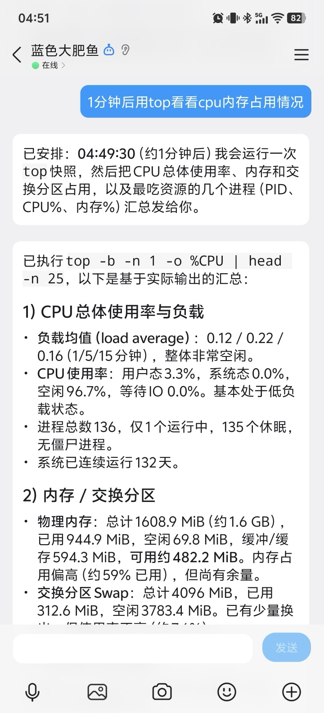
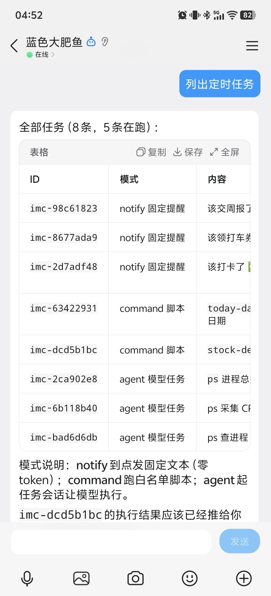

# dsh-im-cron

[English](README.md) | **简体中文**

[](https://github.com/deepseek-ai/deepseek-harness)

**一个 [DeepSeek Harness](https://github.com/deepseek-ai/deepseek-harness)（DSH）插件**，给 [`@xmanrui/dsh-im`](https://www.npmjs.com/package/@xmanrui/dsh-im) 补上定时这一层：在聊天里创建任务，到点执行，结果推回**同一个聊天**。

> 它是 dsh-im 的配套插件，不是独立的 IM 渠道。

## 截图

| QQ 里创建并执行一个 `agent` 定时任务 | 在聊天里 `imcron_list` |
|---|---|
|  |  |

---

## 它做什么、不做什么

本插件**不连 IM 平台、不发消息、不管理会话**。它只决定**什么时候跑、跑什么、结果交给谁**；渠道归 dsh-im。

| 关心什么 | 谁负责 |
|---|---|
| IM 连接、会话绑定、主动发送、目标管理 | **dsh-im** |
| 排期、执行、取结果、记账 | **本插件** |

投递通过 dsh-im 的 `dshIm` 服务（`contractVersion: 1`）完成。本插件不 import dsh-im 代码，只调用 `send` / `describeConversation` / `resolveTarget`。

DSH 自带的 `schedule_*` 跑在会话里，答案是否推回聊天取决于 `deliverModelAnswers`（默认关），所以"9 点提醒我"在原生调度下默认静默。本插件把三件事拆开：

| 问题 | 答案 |
|---|---|
| 什么时候跑 | 本插件的调度器（见[调度精度](#调度精度)） |
| 在哪跑 | `agent` 载荷用任务专用会话，不绑定聊天 |
| 发给谁 | dsh-im 的 `botId + targetId`，与会话解耦 —— 用户 `/new` 不影响投递 |

**没装 dsh-im 时**：配置里声明的 `jobs`（自带 target）照常执行、记 `runs.jsonl`，但没有投递通道 —— 投递会退避重试，运行记录里 `deliver.status` 为 `pending`。在聊天里建任务需要 dsh-im，因为投递目标要从会话解析。

```text
你（QQ）：每天早上 9 点提醒我写日报
机器人：已建好 imc-98c61823，下次 11-23 09:00

—— 第二天 09:00 ——
机器人：写日报 ✍️
```

---

## 三种载荷

| 载荷 | 到点做什么 | 模型成本 |
|---|---|---|
| `notify` | 发一条固定文本 | **0** |
| `command` | spawn 一个脚本，stdout 回推 | **0** |
| `agent` | 在任务专用会话里跑**一个**回合，答案回推 | 1 回合 |

`notify` / `command` 全程不经过模型；`agent` 只有执行经过一次模型，投递仍然零模型。

---

## 要求

| 项 | 必需 | 版本 |
|---|---|---|
| Node.js | ✅ | `>= 24.9.0`（与 DSH 一致） |
| DeepSeek Harness | ✅ | `>= 0.2.2-rc.0 < 0.3.0`（由 `engines.dsh` 强制） |
| pnpm | ✅ | 任意近期版本；`dsh plugin` 会把参数转发给它 |
| [`@xmanrui/dsh-im`](https://www.npmjs.com/package/@xmanrui/dsh-im) | **✅ 投递必需** | `5.10.0`（`dshIm` 契约按此版本验过） |
| 平台 | — | macOS 已实测；Linux 预期可用但未实测；Windows 仅静态检查 —— `command` 载荷只接受 `.exe`/`.com`（不经 shell，不支持 `.sh`/`.cmd`/`.bat`） |

---

## 渠道

路由是表驱动的，route 形状对齐 dsh-im 的 `normalizeRoute`。

| 渠道 | 私聊 | 群聊 | route 键 | 状态 |
|---|---|---|---|---|
| `qq` | ✅ | ✅ | `userOpenId` / `groupOpenId` | 真机实测 |
| `feishu` | ✅ | — | `openId` | 结构支持；群聊与话题拒绝 |
| `weixin` | ✅ | — | `toUserId` | 结构支持；dsh-im 没有群聊 route |
| `dingtalk` | ✅ | ✅ | `userId` / `openConversationId` | 结构支持 |
| `wecom` | ✅ | ✅ | `chatId`（两者相同） | 结构支持 |

`allowChannels` 默认包含这五个渠道。渠道本身还需要 dsh-im 里有活跃的机器人；这个列表只控制哪里允许创建任务。私聊地址取 `senderId`（wecom 同时把 `chatId` 设成同一个 id）；群聊地址取 `chatId`。飞书群聊/话题（`channel-unsupported` / `thread-unsupported`）、weixin 群聊，以及其他 dsh-im 渠道（`slack`、`telegram` 等）都会明确拒绝。

上面的状态是如实标注：只有 QQ 跑过真实机器人；其余是按 dsh-im 源码核对并用单测覆盖。声明式 `jobs` 的 `target.channel` 默认是 `qq`，其他渠道要显式写。

---

## 安装

**① 确认 pnpm 在 PATH 上**（`dsh plugin` 会把参数转发给 pnpm）：

```bash
npm install -g pnpm    # 已经能跑 `pnpm --version` 就跳过
```

**② 先装并配好 dsh-im**（至少一个渠道的机器人 + 接收目标），确认能正常收发：

```bash
dsh plugin --profile web add @xmanrui/dsh-im
```

**③ 再装本插件**：

```bash
dsh plugin --profile web add dsh-im-cron                 # 从 npm
dsh plugin --profile web add github:mashago/dsh-im-cron  # 从仓库
dsh plugin --profile web add /path/to/dsh-im-cron        # 本地目录 / tarball
```

**④ 重启 `dsh web`**，新行才会加载。插件代码是启动时读取的，启用/升级同样要重启。`github:` 安装会锁住解析到的 commit，升级要 `remove` 再 `add`（直接 `add` 不会刷新 lockfile）。

两者必须在**同一个 DSH 实例、同一个 profile** 里 —— 本插件通过 `ctx.get('dshIm')` 找它。

确认两行已插入：

```bash
dsh --profile web --dump-config | grep im-cron
```

启动日志应出现：

```text
[im-cron] delivery=dshIm agent=on jobs=N stateDir=~/.dsh/im-cron
```

`delivery=pending` 表示启动时没探测到 dsh-im（之后每次使用都会重新探测）：`notify` / `command` 仍会执行，投递保持 pending。

> **主配置行（`im-cron`：`timezone`、`scriptDir`、`activeHours`、`jobs`、各种上限…）改后需要重启 DSH。**
> 只有两处是热生效的：群聊开关，以及插件页里的「配置任务会话」（保存后下一次 agent 任务执行生效）。

---

## 快速开始

| 你说 | 建的载荷 |
|---|---|
| 「1 分钟后提醒我开会」 | `notify` + `at` |
| 「每天早上 9 点提醒我写日报」 | `notify` + `cron` |
| 「1 分钟后跑 stock-report.sh，跑完告诉我」 | `command` + `at` |
| 「每天 15:30 跑收盘脚本，不用通知我」 | `command` + `cron` + `notify:never` |
| 「每天 9 点帮我汇总财经新闻」 | `agent` + `cron` |
| 「每 2 分钟查一次进程，跑 3 次就停」 | `agent` + `every{minute,2}` + `maxRuns:3` |

脚本载荷需要先把脚本放进[脚本目录](#脚本载荷)。

---

## 工具

9 个工具，全部在全局行 `im-cron-tools` 注册，任何 agent 都能看到。

| 工具 | 作用 | 关键参数 |
|---|---|---|
| `imcron_remind` | 到点发固定文本 | `text`、`at`/`cron`/`every`、`timezone?`、`maxRuns?` |
| `imcron_run` | 到点 spawn 脚本 | `script`、`timeoutSeconds?`、排期、`notify?`、`maxRuns?` |
| `imcron_ask` | 到点跑一回合 | `prompt`、排期、`notify?`（`always`/`never`）、`timeoutSeconds?`、`maxRuns?` |
| `imcron_list` | 本聊天的任务、下次运行、上次结果 | — |
| `imcron_update` | 改排期 / 文案 / `notify` / `maxRuns` | `id` + 上述字段 |
| `imcron_remove` | 删任务（**不删投递目标**） | `id` |
| `imcron_pause` / `imcron_resume` | 暂停 / 恢复 | `id` |
| `imcron_trigger` | 立即执行一次，不改排期与水位 | `id` |

行为约定：

- 创建返回 `{ id, nextRunAt, next3 }`；`next3` 让用户当场核对时间。
- `imcron_update` 只改排期 / 文案 / `notify` / `maxRuns`；**载荷类型和目标不可改**，要换就删了重建。
- 改排期会**重新锚定**（旧槽不再触发），并清除 `needs-rebind` 或 `invalid`，让任务重新可跑。只改文案不会清状态；修好目标（或载荷）后用 `imcron_resume`。
- `imcron_resume` 也会清 `needs-rebind` 和 `invalid`。清 `invalid` 不等于修好载荷：下一次运行还会失败并记下原因，这是聊天里建的任务唯一能看见的信号（它的载荷没法通过工具修改）。
- `imcron_list` 不返回 `sessionId`（只在 CLI `--verbose` 和 `runs.jsonl` 里），显示**启用 / 暂停 / 已结束**，需要重新绑定或载荷无效时给出提示。
- 目标隔离：模型不能指定 bot 或聊天，目标从当前会话反查；管理工具看不到别的聊天的任务（别人的 id 与"不存在"返回同一个错误）。
- `imcron_trigger` 不消耗 `maxRuns` 预算。

### 原生 `schedule_*` 在 IM 会话里被禁用

三层，只有最后一层是强制的：

| 层 | 机制 |
|---|---|
| 提示 | 系统提示段 `tool:imcron`（只对 IM 会话生效，按会话 id 过滤） |
| 可见 | `agent/created` → `tools.restrict({deny:['schedule_create','schedule_edit','schedule_list','schedule_view']})` |
| **执行** | `tools/execute` 守卫返回 `isError`，工具体不执行 |

原生定时任务的回答默认不推送，而模型会优先点它。**Web / 桌面会话完全不受影响。**

---

## 时间表达式

三种，**互斥**：

```jsonc
// 一次性
{ "at": "2026-11-21T09:00:00+08:00" }
{ "at": { "date": "2026-11-21", "time": "09:00", "timezone": "Asia/Shanghai" } }

// 墙上时钟规律（5 段）
{ "cron": "0 9 * * 1-5", "timezone": "Asia/Shanghai" }   // 工作日 9 点
{ "cron": "0 9,18 * * *" }                               // 每天 9 点和 18 点
{ "cron": "0 9 1 * *" }                                  // 每月 1 号
{ "cron": "0 9 L * *" }                                  // 每月最后一天

// 间隔
{ "every": { "unit": "minute", "count": 90 } }                            // 每 90 分钟
{ "every": { "unit": "hour", "count": 3 } }                               // 从现在起每 3 小时
{ "every": { "unit": "day", "count": 15, "at": "06:00", "timezone": "Asia/Shanghai" } }
{ "every": { "unit": "week", "count": 2, "at": "10:00", "timezone": "Asia/Shanghai" } }
```

| 用户说的 | 用 |
|---|---|
| 某个时刻 / 某一天 | `at` |
| 工作日、一天多个时刻、每月某天、某个月 | **`cron`**（`every` 表达不了） |
| 每 N 分钟 / 小时 / 天 / 周 | `every` |

规则：

- `cron` 只接受 5 段；拒绝秒字段、宏（`@daily`）、"值 + 步长"（`0/15`），以及没有未来触发时间的表达式（如 `0 9 30 2 *`）；支持 `L`（月末）。
- `cron` 写**本地墙上时间**，不要先换算成 UTC。
- `*/15` 是「每月 1、16、31 号」，**不是**「每隔 15 天」。要后者用 `every{day,15}`。
- `every` 的 `minute` / `hour` 是**瞬时制**：锚定创建时的整分，跨 DST 间隔不变。
- `every` 的 `day` / `week` 按**本地日历**推进：跨 DST 保持墙上时间，缺口顺延、重叠取较早。
- `at` 必须严格未来；落在 DST 缺口的时刻直接拒绝。

> **首次触发**：`every{day|week, at}` 从**第一个未来的 `at` 时刻**开始 —— 下午建的「每 15 天早上 6 点」首次在**明天** 06:00，不是 15 天后。`minute` / `hour` 从创建时刻的整分起算。创建时返回的 `next3` 就是用来核对的。

---

## 配置

```yaml
- insert:
    - id: im-cron
      name: dsh-im-cron
      config:
        timezone: Asia/Shanghai
        scriptDir: ~/.dsh/im-cron/workspace
        activeHours: { start: '08:00', end: '22:00' }
        agent:
          enabled: true
          timeoutSeconds: 900
          permissionPreset: danger-full-access
        # 运维声明的任务（不经模型）
        jobs:
          - id: decl-close
            name: 收盘行情
            schedule: { cron: '30 15 * * 1-5', timezone: Asia/Shanghai }
            payload: { kind: command, script: stock-report.sh }
            deliver: always
            target: { botId: qq_xxxxxxxxxxxxxxxx, targetId: cron-0123456789ab }
```

| 键 | 默认 | 说明 |
|---|---|---|
| `channel` | `dshIm` | 渠道标识（当前仅 dsh-im） |
| `stateDir` | `$DSH_HOME/im-cron` | 状态目录 |
| `scriptDir` | `<stateDir>/workspace` | 脚本目录，见[脚本载荷](#脚本载荷)。**插件不创建它** |
| `timezone` | 宿主时区 | 排期解析 / 展示的默认时区 |
| `pollSeconds` | `30` | 兜底扫描间隔（不是触发精度，见[调度精度](#调度精度)） |
| `activeHours` | 空（全天） | 执行时间窗 `{start, end, timezone?}` |
| `defaultTimeoutSeconds` | `600` | 脚本默认超时 |
| `endedRetentionHours` | `24` | 一次性任务结束后保留多久；`0` = 不清理 |
| `maxNotifyChars` | `2000` | 提醒文本上限（创建时校验） |
| `maxJobs` / `maxJobsPerTarget` | `500` / `50` | 任务容量上限 |
| `allowChannels` | 全部已支持渠道 | 允许创建任务的渠道（`qq`、`feishu`、`weixin`、`dingtalk`、`wecom`） |
| `allowGroup` | `false` | 是否允许群聊建任务（**群聊里脚本载荷一律禁用**）；插件页可即时切换 |
| `jobs` | `[]` | 声明式任务，启动时按 id upsert（保留既有水位） |
| `agent.enabled` | `true` | 探测不到 `sessionController` 时只禁用 `agent` 载荷 |
| `agent.timeoutSeconds` | `900` | agent 回合的**软截止** |
| `agent.stuckGraceSeconds` | 空（软截止 × 2） | agent 回合的**硬截止** |
| `agent.maxConcurrent` | `2` | 同时运行的 agent 回合上限 |
| `agent.permissionPreset` | 空 | 任务会话的权限档，见[权限档](#权限档) |
| `agent.taskSessionMaxAgeDays` | `30` | 任务会话超过这个天数换新 |

每个键都声明在插件的 `Config` 里，Loader 会做类型校验并填默认值。**非法配置会让这个插件行加载失败**，而不是静默用默认值；语义错误（比如 `activeHours` 格式不对）在启动时报出字段名。时区不可用时只 warn 并回退宿主时区。**键名**拼错不会让整行失败：会报 `未知配置项` 并忽略，所以 `pollSecond` 不会静默地看起来生效了。CLI 保留逐字段回退。

`jobs` 是声明式任务的唯一来源：删掉某个条目（或整份列表）会在下次启动时删除对应任务；聊天里创建的任务不受影响。某条声明写法非法时只跳过该条并给出 warning，其余任务照常运行 —— 一处手误不该让整个排期停摆。如果声明写法非法或排期非法，那一次启动也跳过清理，不去猜哪些任务被删了。

`activeHours`：

- 窗口外的槽**直接跳过**，不延后。
- `end` 可写 `24:00`；`start > end` 表示跨夜（如 `22:00`–`06:00`）。
- `start === end` 等于**关闭所有槽**。
- 时区非法时只 warn，不限制。

主配置弹窗里只会出现 `allowGroup`（DSH 只渲染 volatile 字段）。`agent.*` 在单独的「配置任务会话」弹窗 / `im-cron-agent` 行里改；其余配置走 YAML + 重启。

---

## 脚本载荷

`imcron_run` 只接受**一个已存在的可执行文件**，不接受 shell 字符串。

```bash
mkdir -p ~/.dsh/im-cron/workspace
cat > ~/.dsh/im-cron/workspace/stock-report.sh <<'EOF'
#!/bin/sh
echo "报告生成于 $(date '+%F %T %Z')"
EOF
chmod +x ~/.dsh/im-cron/workspace/stock-report.sh
```

脚本必须：

1. 位于 `scriptDir` 内（相对名或绝对路径都行，**解析后必须仍在目录内**）
2. 是普通文件
3. 可直接执行：POSIX 上要有执行权限和 shebang；Windows 上必须是原生 `.exe`/`.com`（批处理/shell 脚本请用 exe 包装）

拒绝情况：

| 错误码 | 触发条件 |
|---|---|
| `script-dir-missing` | `scriptDir` 不存在 |
| `script-not-found` | 文件不存在 |
| `script-outside-dir` | `realpath` 解析后跑出目录（含 `../` 与符号链接） |
| `script-not-executable` | 没有执行权限（POSIX） |
| `script-platform-unsupported` | 该平台不能直接 spawn 这个脚本（Windows 只支持 `.exe`/`.com`） |
| `command-not-allowed-in-group` | 在群聊里创建脚本任务 |

运行约定：

| 项 | 值 |
|---|---|
| cwd | `scriptDir` |
| 环境变量 | `IMCRON_JOB`、`IMCRON_OCCURRENCE` |
| 超时 | 任务 `timeoutSeconds`，否则 `defaultTimeoutSeconds` |
| 成功判定 | exit 0 |
| 投递内容 | stdout；stdout 为空则 stderr；失败时带 exit 码 + stderr 尾部 15 行 |

---

## 投递策略

| `deliver` | 成功 | 失败 |
|---|---|---|
| `always` | 发结果；结果为空则发 `✅ <任务> 完成（无输出）` | 发 `⚠️ <任务> failed` + 摘要 |
| `on-failure` | 不发 | 同上 |
| `never` | 不发 | 不发（只写 `runs.jsonl`） |

默认值：`notify` → `always`，`command` → `on-failure`，`agent` → `always`。

dsh-im 没有 `retryable` 标记，按错误码判定：

| 错误码 | 处理 |
|---|---|
| `bot-not-connected`、`cancelled`、`channel-unavailable` | 留 `pending`，退避重试（5s、30s） |
| `delivery-failed` / `send-result-unknown` | **不重试**（可能已发出一部分，重发就是重复），最多换纯文本再发一次 |
| `unknown-bot` / `unknown-target` | 任务标 `needs-rebind`，告警一次 |
| `invalid-target` / `bad-request` / `capability-unavailable` 等 | 记 `failed`，不重试 |

---

## 调度精度

| 机制 | 作用 | 精度 |
|---|---|---|
| **截止点定时器** | 指向最近的 `nextDue`，到点直接触发 | 毫秒级 |
| **兜底扫描**（`pollSeconds`） | 休眠、时钟跳变、定时器失效后再跑一轮 | ≤ `pollSeconds` |

定时器是优化，扫描是"发现到点"的保证。各任务独立执行 —— 一个慢 `agent` 回合不会拖住其他任务（同一任务仍然单飞）。

DSH 停机或主机休眠期间错过的槽**直接跳过**；只有落在 freshness 窗口（`max(2 × pollSeconds, 60s)`）内的槽仍会触发。超过 6 小时的等待会分片重算（顺带处理 DST）。实测偏差：**9–38 ms**（多数 10 ms 量级）。

---

## `agent` 载荷

- 一条任务一个**任务专用会话**：首跑 `sessionController.create({cwd, agentPreset})`（配了模型路由就用 `agent.model.select` 把它 pin 到该 Agent 上，先经 `llm.resolveCallConfig` 校验），之后 `resolveAgent` 复用；改模型/强度时只原地重设，不重建。cwd 默认是插件状态目录（`$DSH_HOME/im-cron`）；要换就在 agent 任务会话设置里填 `cwd`。
- 会话**不绑定聊天** → 渠道不会镜像它 → 答案只在插件 `send` 时出现**一次**。
- 回合归属靠我们那条 `followup` 的 message id：`turn/start` 只带 `{turn}`，`user/message` 命中我们的 id 才认领，`turn/end` 同 turn 收尾。
- **两段式超时**：软截止只记日志、继续等；硬截止仍未结束才 `cancel({kind:'user'})` 并记 `failed/stuck`。软硬之间完成的回合照常投递真实答案。
- 并发：`agent.maxConcurrent`，等待超过 `2 × pollSeconds` 记 `skipped: busy`；同一任务上一轮没结束则 `skipped: running`。
- 自愈：`session/not-found` → 重建；`turn/end` 为 `blocked`（会话被归档）→ 丢会话、下一轮重建。
- 会话标题写成 `⏰ <任务名>`（用户手动改过的标题不会被覆盖）。

### 权限档

`agent.permissionPreset` 只作用于**任务会话**（写该会话自己的日志），不影响聊天或 Web 会话。

| 值 | sandbox | approval | 后果 |
|---|---|---|---|
| 留空 | 部署默认（`workspace-write` + `ask`） | | 需要审批的调用会**挂到超时**（见[已知限制](#已知限制)） |
| `workspace-write` | 工作区内可写 | `ask` | 同上 |
| `danger-full-access` | 全开 | `never` | 无沙箱、不审批；`ps` / `top` 等 setuid 程序可执行 |

等价的手写配置：

```yaml
- id: im-cron-agent
  name: dsh-im-cron/agent-settings
  config:
    cwd: ~/.dsh/im-cron
    provider: deepseek-account
    model: deepseek-flash
    reasoningEffort: low
    permissionPreset: danger-full-access
```

也可以在 **Web → 插件 → dsh-im-cron → 配置任务会话** 里改。模型提供方 / 模型 / 推理等级从宿主的模型目录（`session/modelCatalog`）里选：一个按 provider 分组的模型列表，以及只列出所选模型支持档位的推理等级列表，两者都保留「跟随部署默认 / 跟随模型默认」。模型目录读不到时该表单回退成纯文本框，仍可手填保存。保存后**下一次 agent 任务执行**生效（字段是 Loader volatile，`agent-turn.js` 每轮重新读取）。模型 / 推理等级 / 权限档对**正在用的任务会话原地生效**；只有 `cwd`、`agentPreset` 变更或把模型改回「跟随部署默认」才重建会话。任务的模型设置不会改动部署默认模型。同一个弹窗里还有群聊开关。通知 / 脚本载荷不受影响。

---

## 执行次数上限

建任务时可选 `maxRuns`（1–10000）：跑满 N 次计划执行后自动标记结束。

- **只计计划执行**：`imcron_trigger` 不消耗次数。
- 被中断的执行（进程重启）**计入**。
- `imcron_update` 改 `maxRuns` 会重置计数。
- `imcron_list` 显示进度：`已跑 2/3`。

---

## CLI

```bash
node cli.js doctor                        # 状态目录、任务计数、脚本目录、最后一条运行
node cli.js list [--verbose]              # 任务、下次运行、上次结果（--verbose 带 sessionId）
node cli.js run <id> [--config cfg.json]  # 立即执行一次（CLI 无通道，投递记 skipped）
node cli.js log [--job <id>] [-n 50]      # runs.jsonl 尾部
```

通用参数 `--state-dir DIR`（默认 `$DSH_HOME/im-cron`）。

---

## 状态与文件

```
$DSH_HOME/im-cron/
  state.json              { version: 1, jobs: [...] }
  state.json.bak          上一次写入前的副本
  runs.jsonl              运行记录，一行一条
  workspace/              脚本目录（默认值，需手动创建）
```

- 写入是 `tmp → fsync → rename`。
- `state.json` 损坏时复制成 `state.json.corrupt-<时间戳>`，**按空状态启动**，DSH 不受影响。
- `runs.jsonl` 字段：`at`、`jobId`、`mode`、`occurrence`、`trigger`、`durationMs`、`result{kind,exit?,reason?}`、`deliver{status,attempts?,error?}`、`sessionId?`、`turn?`、`textTail?`。

### 幂等

对任意 `(jobId, occurrence)`，**磁盘状态只允许启动一次执行**：

1. 执行前把占位（`lastFiredFor` + `endedAt` + `inflight`）fsync 到 `state.json`；
2. 占位落盘失败则**本轮不执行**；
3. 进程在执行中退出 → 启动时记一条 `result.kind=interrupted` 并清掉占位，**不重放**（at-most-once）。

---

## 源码布局

```
index.js             插件装配：探测 dshIm / sessionController → 调度器 + 守卫 + 声明式任务
config.js            校验、默认值、路径/时区归一化
tools.js             9 个 imcron_* 工具（全局行 im-cron-tools）
agent-settings.js    Loader 行 im-cron-agent（Web 表单）
client.js            Plugins 页表单
diag.js              按需诊断日志

core/schedule.js     at / cron / every 解析、nextDue、DST 墙上时间引擎
core/scheduler.js    截止点定时器 + 兜底扫描、原子占位、崩溃恢复、activeHours、maxRuns
core/job.js          载荷分派 → 投递三态 → runs 记账
core/agent-turn.js   任务会话、回合归属、两段式超时、答案提取
core/scripts.js      脚本路径解析与目录越界校验
core/exec.js         进程 spawn、进程树、输出尾部
core/store.js        state.json 原子写、runs.jsonl、损坏隔离

channel/dsh-im.js    send / resolveTarget / describeTarget / describeConversation(+Sync)
cli.js               doctor / list / run / log
examples/            示例配置与演示脚本
```

`channel/dsh-im.js` 是**唯一**跟 dsh-im 打交道的文件；`core/` 全部与渠道无关。

---

## 与 dsh-im 的契约

本插件只依赖 dsh-im 暴露的**服务方法**，不 import 它的代码、不读它的状态文件：

| 方法 | 用途 |
|---|---|
| `send(botId, targetId, text, { format })` | 主动发送，零 session / 零回合 / 零模型 |
| `describeConversation(sessionId)` | 会话 → `{channel, botId, chatType, chatId, senderId}` |
| `describeConversationSync(sessionId)` | 同上，内存快路径；路由守卫和提示作用域用它 |
| `listTargets(botId)` | 复用已保存的投递目标 |
| `createTarget(botId, {targetId, name, kind, route})` | 首次建目标（只接受这 4 个键） |

启动时检查 `contractVersion >= 1`；缺任何一个方法就只禁用投递，插件本身照常加载。

**dsh-im 升级时先看两件事**：`contractVersion` 有没有变、`send` 的参数形状有没有变。适配层集中在 `channel/dsh-im.js`。

> 也支持在 profile 里手写两行代替 bundle 安装，见 `examples/config.yml`。

## 安全模型

| 面 | 控制 |
|---|---|
| 能跑什么（脚本） | 只能是 `scriptDir` 内的**已存在可执行文件**；不接受 shell 字符串；群聊里整体禁用 |
| 能跑什么（agent） | 只看任务会话的 preset 工具集；不改用户聊天会话；审批无人应答时挂到超时 |
| 能发给谁 | 目标只能由当前会话反查，模型不能指定 bot / 聊天 |
| 能发多少 | `maxJobs`、`maxJobsPerTarget`、`maxNotifyChars`，创建时校验 |
| 能跑多少 | `agent.maxConcurrent`、同一任务单飞；`cron`/`every` 最小粒度 1 分钟（`at` 可到秒） |
| 审计 | 每次运行与投递写 `runs.jsonl`（不含凭据） |

---

## 故障排查

| 现象 | 先看 | 处理 |
|---|---|---|
| 到点没跑 | `cli.js list` 的 `下次`、`cli.js doctor` 的任务计数 | 确认 DSH 在跑、任务启用；精度靠定时器，`pollSeconds` 只是兜底 |
| 跑了但没收到 | `runs.jsonl` 的 `deliver.status` / `error` | `bot-not-connected` 等重连；`unknown-target` → `needs-rebind`：修好目标后 `imcron_resume`（或改一次排期） |
| 模型说"建不了任务" | 聊天是否在已支持渠道、`allowGroup`、`allowChannels` | 工具只在 IM 会话里可用 |
| 模型没调 `imcron_*` | preset 是否屏蔽了工具 | 检查 profile / preset 的工具集 |
| agent 任务一直跳过 | `result.reason` | `running` = 上一轮没结束；`busy` = 超出 `maxConcurrent` |
| agent 报 `stuck` | 任务会话日志里的 `approval/asked` | 多半停在 `ask` 上无人应答；配 `danger-full-access` |
| 出现 `result.kind=interrupted` | 上一条同任务的 `inflight` | 进程在执行中退出；该槽不重放。一次性任务已标记结束，需要就重新创建 |
| 任务里 `ps` / `top` 报 `Operation not permitted` | 任务会话的 `sandbox/mode` | `workspace-write` 不允许 exec setuid 程序；改用 `pgrep` / `lsof`，或配 `danger-full-access` |
| 脚本任务建不了 | `cli.js doctor` 的 `scriptDir` 行 | 目录不存在、文件不在里面、没 `chmod +x`，或 Windows 上不是 `.exe`/`.com` |

### 诊断日志

默认关闭。排查调度问题前在**启动 DSH 之前**设置：

```bash
IMCRON_DIAG=1 dsh web
IMCRON_DIAG=1 IMCRON_DIAG_FILE=/tmp/imcron-trace.log dsh web   # 改输出位置
```

JSON Lines，每行 `<ISO 时间> [<模块实例id>] <事件名> {<JSON>}`。同一进程出现**两个不同的实例 id** 说明插件模块被加载了两份 —— 这是"配置不生效"的典型原因。`npm test` 下不写。

---

## 已知限制

- **`workspace-write` 下 `ps` / `top` / `sudo` 一律不可用。** 它们是 setuid 二进制，Seatbelt 不允许 exec，报 `Operation not permitted`。只能 `danger-full-access`，或改用 `pgrep` / `lsof` / `vm_stat` / `iostat`。
- **审批会挂住无人值守的回合。** 有 Web GUI 在线时（它注册了 `approval/request` 应答者），请求会排进任务会话界面等人点；无人应答就等到软截止超时。只有完全没有应答者时才瞬时 fail-closed。无人值守请配 `danger-full-access`。
- 群聊主动消息可能被平台限流，失败记 `delivery-failed`，不自动重发（可能已发出）。
- 群聊**不支持脚本载荷**。
- CLI 没有投递通道，`cli.js run` 一律记 `deliver=skipped`。
- 任务会话出现在 Web 侧栏 **Ungrouped** 分组（标题 `⏰ <任务名>`）。默认每 30 天轮换，**旧会话不会自动删除**。
- 提醒文本上限在**创建时**校验；脚本 / 模型输出不设上限，由 dsh-im 按 4500 字分片。
- 同一任务的 agent 回合**单飞**：上一轮没跑完时本次记 `skipped: running`。
- 多实例共用同一 `stateDir` 时，幂等只在单进程内成立（启动恢复会接管残留占位）。
- 投递服务目前只实现了 dsh-im；接其他服务需要新写 `channel/*.js`。
- 飞书群聊/话题、weixin 群聊会被拒绝；dingtalk、wecom、feishu 未跑真实机器人，Windows 只做静态检查。
- `runs.jsonl` 只追加，`imcron_list` 会扫描它；每分钟任务大约每年增长 0.25–0.5 GB。每天任务可以忽略。

---

## 实现说明

- 全部配置声明在 `Config` 里；默认值只存在于 `config.js`，非法值会让插件行加载失败（某条 `jobs` 声明写法非法时只跳过该条，避免一处手误让所有任务停摆）。
- 工具用裸 `ToolDefinition` 注册（不依赖 `@deepseek-ai/dsh-tools`），每个 execute 自己校验参数，避免依赖与宿主强耦合的包版本。
- `@deepseek-ai/schemastery` 是 dependency、不是 peer：profile 和 `link:` 安装不提供它，而 schema 对象按结构消费。

---

## 开发

```bash
npm install
npm test          # node --test，241 个用例
```

测试覆盖：时间表达式与 DST、调度器的原子占位 / 崩溃恢复 / `maxRuns` / `activeHours`、三种载荷与投递三态、回合归属与超时、脚本路径校验、工具参数与文案。

---

## 许可证

[MIT](LICENSE)